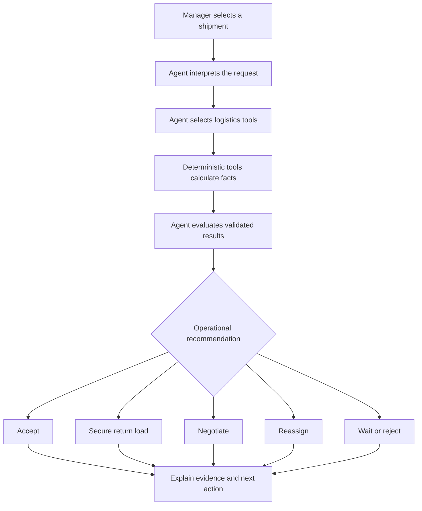

# HaulSense
### Agentic Freight Decision Platform

<p align="center"><strong>Make every dispatch decision with the complete trip in view.</strong><br/>An AI-assisted freight decision and fleet operations platform for transport operators.</p>

<p align="center">


</p>

HaulSense explores a practical question for freight operators:

> **Should we accept this shipment, negotiate it, assign another vehicle or driver, or secure a return load before committing the truck?**

Freight decisions are often split across calls, spreadsheets and disconnected estimates. HaulSense brings shipment economics, fleet suitability, driver reliability, operational risk and return-load opportunities into one decision-support workflow.

Its central engineering principle is simple: **code calculates; the AI agent reasons over validated tool results.** The agent can interpret a request, select logistics tools, inspect their outputs and explain an operational recommendation. It should not invent numerical results.

## Contents
- [Why HaulSense](#why-haulsense)
- [Platform capabilities](#platform-capabilities)
- [Agent decision workflow](#agent-decision-workflow)
- [Technology](#technology)
- [Architecture](#architecture)
- [Run locally](#run-locally)
- [Configuration](#configuration)
- [Demo boundaries](#demo-boundaries)
- [Security](#security)
- [Validation](#validation)
- [Documentation](#documentation)
- [Roadmap](#roadmap)

## Why HaulSense

A quoted freight rate is not the same as the actual trip-cycle value. Fuel, tolls, driver allowances, vehicle suitability, delivery constraints and the probability of an empty return can change the decision.

HaulSense evaluates the complete trip cycle—not merely the outbound price per kilometre.

- Evaluate outbound trip economics.
- Account for empty-return (deadhead) cost.
- Search for geographically and temporally compatible return loads.
- Compare the effect of a secured backhaul.
- Check vehicle capacity and cargo compatibility.
- Include driver reliability and operational risk in the decision.

## Platform capabilities

The repository contains these application areas and decision-support modules:

| Area | Purpose |
| --- | --- |
| Operations dashboard | Fleet, shipment and operational overview |
| Live Fleet Tracking | Map-based fleet visibility and trip telemetry workspace |
| Shipments | Shipment records and lifecycle operations |
| Vehicles & Drivers | Fleet resources, driver records and matching |
| Return Loads | Backhaul discovery and trip-cycle evaluation |
| Agent workspace | Shipment-specific AI decision workflow |
| Driver portal | Trips, trip map, vehicles, loads, earnings, trust, health and documents |
| Trip communications | Driver–manager trip communication |
| Diagnostics | Development and ground-truth inspection |

### Agent toolset

1. **Trip profitability** — fuel and operating costs, profit, margin and break-even freight.
2. **What-if simulation** — sensitivity to freight rate, fuel price, tolls and mileage.
3. **Driver trust passport** — configured reliability indicators and incident history.
4. **Return-trip search** — compatible backhauls and round-trip economics.
5. **Vehicle matching** — payload capacity and cargo compatibility.
6. **Negotiation simulation** — margin-based counter-offers and commercial limits.
7. **Risk evaluation** — explicit point-based operational risk scoring.
8. **Recommendation submission** — structured decision, decisive factors and next directive.

### Possible decision outputs

- **ACCEPT**
- **ACCEPT + SECURE RETURN LOAD**
- **NEGOTIATE**
- **REASSIGN**
- **WAIT**
- **REJECT**

These are decision-support outcomes. A human operator remains responsible for approving real-world dispatch commitments.

## Agent decision workflow



| Deterministic application logic | AI agent |
| --- | --- |
| Cost, margin and break-even calculations | Understands the operator's question |
| Vehicle-capacity validation | Selects relevant tools |
| Risk-score computation | Interprets tool results |
| Input and output schema validation | Explains trade-offs |
| Lifecycle validation | Produces a next-step directive |

## Technology

| Layer | Technology |
| --- | --- |
| UI | React 19, TypeScript |
| Build tooling | Vite |
| Styling | Tailwind CSS 4 |
| Backend | Node.js, Express |
| AI integration | Google GenAI SDK |
| Maps | Google Maps React integration |
| Validation | Zod |
| Charts | Recharts |
| Motion | Motion |
| Icons | Lucide React |
| Routing | React Router |

## Architecture

```text
.
├── server.ts                 # Express API server
├── package.json              # Scripts and dependencies
├── vite.config.ts            # Vite configuration
├── .env.example              # Configuration template
└── src/
    ├── App.tsx               # Routes and protected layouts
    ├── agent/                # Agent orchestration
    ├── components/           # Manager and driver UI
    ├── context/              # Authentication and logistics state
    ├── data/                 # Domain and demo data
    ├── pages/                # Manager and driver pages
    ├── tools/                # Deterministic agent tools
    ├── types/                # Shared domain and API types
    ├── utils/                # Shared utilities
    ├── config.ts             # Business and agent constants
    └── main.tsx              # React entry point
```

See [Architecture & Data Flow](docs/ARCHITECTURE.md) for component boundaries, routes and trust boundaries.

## Run locally

Requirements: Node.js compatible with the installed Vite version and npm.

```bash
npm install
npm run dev
```

Open the local URL printed by the development server (the Express server defaults to port **3000**).

Build and start:

```bash
npm run build
npm run start
```

TypeScript validation:

```bash
npm run lint
```

The current `package.json` does not define an `npm test` script. Do not assume a test runner is configured until one is added.

## Configuration

Copy the template for local development:

```bash
cp .env.example .env
```

| Variable | Purpose |
| --- | --- |
| `GEMINI_API_KEY` | Server-side Gemini API access |
| `APP_URL` | Public application URL where required |
| `VITE_GOOGLE_MAPS_API_KEY` | Browser map loading key |

Never commit real secrets. Variables prefixed with `VITE_` are exposed to the browser. Restrict the Maps key by HTTP referrer and permitted APIs. Keep privileged credentials server-side.

## Demo boundaries

This repository includes seeded logistics records and demo-oriented behavior. Some initial fleet telemetry is explicitly marked as **not live device GPS**. A map marker is not proof that a driver's phone is transmitting coordinates.

The inspected server implementation uses in-memory session, audit and telemetry stores. These are useful for prototypes but are not durable multi-instance production infrastructure: process restarts can clear them, and separate server instances do not automatically share state.

The source also contains demo authentication credentials and simulator behavior. Treat these as publicly exposed development shortcuts, not real identity verification. Replace them before any real deployment.

The repository documents Gemini and Google Maps integration. Do not assume a live eGain deployment, production identity provider, persistent cloud database, native background GPS service or production dispatch integration exists unless separately configured and tested.

## Security

- Enforce authorization on the server for every protected operation.
- Scope records by authenticated user and organization.
- Never use seeded identities or simulator shortcuts for real accounts.
- Keep privileged keys out of client bundles and Git history.
- Validate request payloads and trip-state transitions.
- Treat GPS coordinates, trip history and documents as sensitive operational data.
- Define location-sharing notice, access and retention controls.
- Do not claim production security until the hardening checklist is verified.

Read [SECURITY.md](SECURITY.md) and [Security & Data Boundaries](docs/SECURITY_AND_DATA_BOUNDARIES.md).

## Validation

Before proposing or merging changes:
1. Install dependencies.
2. Run `npm run lint`.
3. Run `npm run build`.
4. Exercise manager and driver routes.
5. Test API authorization and invalid inputs.
6. Test map failure and missing-key states.
7. Confirm demo records are labelled and no real credentials are committed.

Only report checks that were actually executed.

## Documentation

- [Project Guide](docs/PROJECT_GUIDE.md) — product purpose, user journeys, calculations and domain language.
- [Architecture & Data Flow](docs/ARCHITECTURE.md) — application boundaries, agent flow and current data architecture.
- [Security & Data Boundaries](docs/SECURITY_AND_DATA_BOUNDARIES.md) — known prototype limitations and production hardening.
- [Contributing](CONTRIBUTING.md) — setup, engineering principles and validation.
- [Security Policy](SECURITY.md) — responsible vulnerability reporting.

## Roadmap

These are improvement areas, not claims that every item is already implemented:

- Durable identity and organization-scoped authorization.
- Persistent shipment, fleet, telemetry and audit storage.
- Verified live smartphone GPS ingestion and retention controls.
- Native Android foreground location tracking for screen-locked trips.
- Traffic-aware route alternatives with measured API usage and fallback behavior.
- Conflict-safe dispatch and assignment workflows.
- Automated tests, CI and operational monitoring.
- Evaluated eGain customer-support workflows and verified backend actions.

---

**HaulSense is an evolving engineering project.** Its documentation distinguishes checked-in code, demo behavior and future production requirements so contributors, reviewers and operators can understand what the system actually does.
