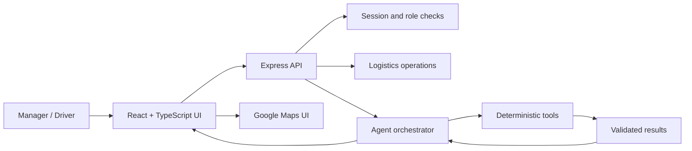
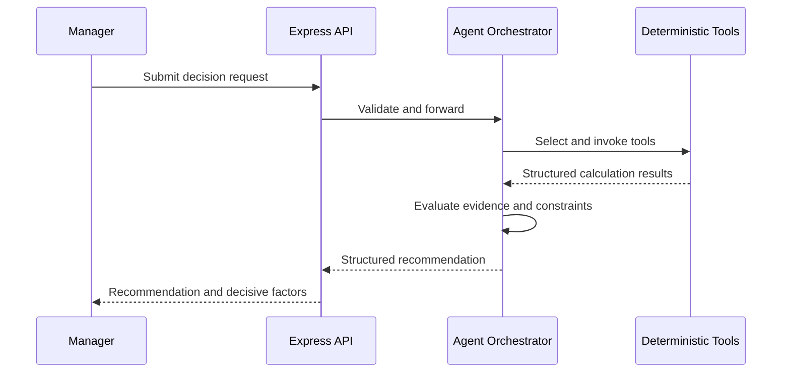

# HaulSense — Architecture & Data Flow

## 1. High-level architecture

This is a conceptual view of the checked-in code. It is not a claim that every production infrastructure component is deployed.

## 2. Frontend boundaries
The React application uses React Router and separate manager and driver layouts. Route definitions live in `src/App.tsx`.

Manager route family: `/manager`, `/manager/tracking`, `/manager/shipments`, `/manager/vehicles`, `/manager/drivers`, `/manager/returns`, `/manager/agent/:shipmentId`, `/manager/chat/:tripId`.

Driver route family: `/driver`, `/driver/trip-map/:shipmentId`, `/driver/trips`, `/driver/vehicles`, `/driver/matching`, `/driver/loads`, `/driver/earnings`, `/driver/trust`, `/driver/health`, `/driver/documents`, `/driver/chat/:tripId`.

Frontend route guards improve navigation but backend authorization remains mandatory.

## 3. Backend responsibilities
The Express application in `server.ts` contains session extraction and expiry checks, manager/driver login flows and simulator handling, role-aware operational endpoints, in-memory audit collection, seeded fleet telemetry, route recommendation logic, trip lifecycle and dispatch operations, trip communication and agent orchestration.

Inspect endpoint implementation before extending it. In-memory stores are neither persistent nor shared across server instances.

## 4. Agent execution boundary

The tool layer owns numerical calculations and domain validation. The agent coordinates tools and explains outputs.

## 5. Data and persistence boundary
The checked-in server initializes in-memory stores for sessions, audit events and fleet telemetry. It imports seeded shipment, driver and vehicle records.

Consequences:
- Process memory can be lost on restart.
- Multiple server processes do not automatically share state.
- In-memory audit logs are not durable compliance records.
- Seeded telemetry is not verified live GPS.

A production architecture needs durable storage, transactional dispatch updates, organization-scoped access controls, retention policies and backups.

## 6. Maps and routing boundary
Map rendering, road routing and device telemetry are separate concerns:
- Map SDK renders maps, markers and overlays.
- Routing service returns road routes, distances and durations.
- Device location obtains coordinates with permission.
- Backend telemetry API authenticates and validates updates.
- Manager subscription distributes authorized trip positions.

Do not infer live GPS or traffic-aware routing solely from the presence of a map SDK.

## 7. Trust boundaries
Treat browser-supplied user IDs, roles, shipment/vehicle/driver/organization IDs, GPS coordinates, uploaded documents, AI-generated text and external route-service responses as untrusted until validated.

Every state-changing API must authenticate the actor, authorize the specific resource, validate the payload and enforce the domain transition on the server.
